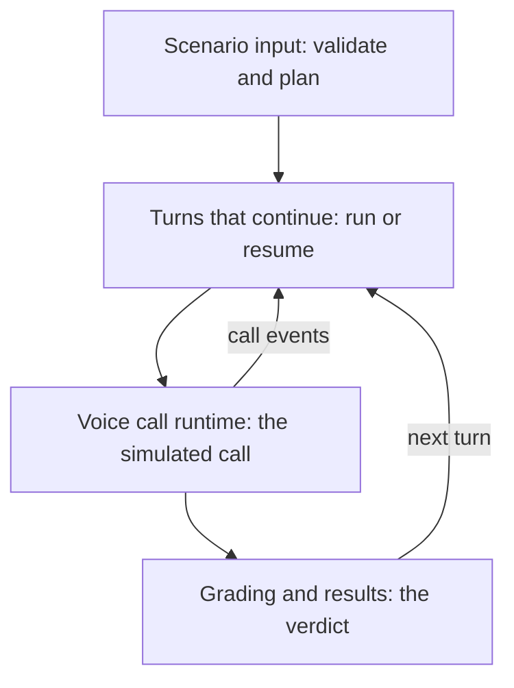

# Pull request description style

How a draft looks. One style for every team: the order of sections, the shape
of each, the rules for tables, diagrams, sizes, and words, the default
template, and a worked example. `SKILL.md` says how the content is gathered
and checked.

## Order

```
## Title
## Description
  the problem                   (a few sentences)
  what this PR does             ("This PR:", then goals and boundaries as bullets)
  what extending it would take  (when the PR is a first step)
  sibling pull requests         (a bullet list, for several repositories)
  ### Where <the new piece> fits (when it joins existing pieces that do similar work)
  ### Scope change              (when it applies)
  ### Client-facing changes     (when it applies)
## Walkthrough
  intro sentence, spine diagram, contents table
  ### <Stage> ...               (one per stage)
  ### Changes to <existing code> (code the base already runs, when any)
  Other files, outside any stage (collapsed)
## Left out on purpose          (when it applies)
  ### Known bugs / follow-ups
  ### Design questions
<the template's other sections, in its order, or the default template>
```

The title is its own first section, apart from the body, so the user copies
each into its own field on GitHub. When the template has a Description
heading, the Description fills it and the Walkthrough follows it; the
template's other sections come after, in the template's order. Every
description has a Walkthrough, however small the change.

Each fact has one home. The Description says why the change exists; the
Walkthrough's contents table lists its parts; each stage says what changes in
it. No section summarizes another, and no list of the parts appears anywhere
but the contents table.

## Title

One line, under about 70 characters, naming what the change adds: "CRM contact
sync: retries and conflict resolution". No ticket or PR number, no emoji, no kind
prefix.

## Description

The Description is a newcomer's first contact with the change. Reviewers range
from the code's owners to people new to it; err toward explaining.

- **No base line.** GitHub shows the branch the PR merges into; never say it
  in prose. Compare as Before and After.
- **The problem.** A few sentences: what is wrong or missing today, in plain
  words. No dense paragraph that also carries the solution.
- **What this PR does.** "This PR:" then bullets, one per goal or boundary,
  each led by a bold phrase ("**is a proof of concept**, scoped to ...",
  "**puts that in the query-builder library** ..."): what it sets out to do,
  how, where it lives, and what it deliberately does not cover. Goals, not
  parts: the contents table lists the parts. It defines no terms beyond what
  the bullets need; the stages define the rest.
- **What extending it would take**, when the PR is a first step (a proof of
  concept, one path converted of many): a sentence or two on what would
  follow if the direction holds.
- **Sibling pull requests**, for several repositories: a bullet list, one per
  repository, each with its number and link (else the branch) and what it
  holds.

### Where <the new piece> fits

When the change adds a piece beside existing pieces that do similar work (a
new builder next to other builders, a new client beside existing ones): one
bullet per piece, the new one included, each led by its bold name and path,
saying what it does and whether this PR changes it. It orients a reviewer
who does not know the neighbors; it does not describe the new piece's
internals, which its stage does.

### Scope change

Only when the PR's scope moved from what reviewers have seen: what left, and
where it went.

### Client-facing changes

When routes or fields change. Input (what callers send) and output (what they
get back) get separate tables, input first, and a field goes in the table of
the direction it travels; a field in both appears in both. Each table is
introduced with every route it applies to, as bullets, saying when the fields
are common to all of them. Columns: Field, Before, After. Every cell is a
short phrase, about six words; detail goes in the stage that explains the
field. Every field the change adds, removes, or renames in a request or
response gets a row, the main break above all. An empty side says "absent" (a
field) or "none". A removed field's
After cell says "removed" and names what replaces it. A break the tables
cannot show (a name checks can no longer read, a behavior callers relied on)
gets one bullet under the table, led by what callers lose. There is no
separate section for what was replaced or removed.

In a client repository, the section is the API it consumes, named "API fields
the UI reads and writes" (or the client's equivalent), with the server's
routes named.

## Walkthrough

Ordered by the spine: the flow a reviewer follows to understand the diff.

1. One or two sentences: the spine (what every unit of the flow passes
   through), which section is not a stage of the flow when one is not
   (deployed code underneath it), and the paths' shared root. One claim per
   sentence, and every section referred to is named, never "the second
   section". Not a summary of the stages; the table is that.
2. With three or more stages, one mermaid diagram of the spine, one idea only,
   its nodes carrying the section names. Top to bottom (`flowchart TD`); left
   to right only when it is three or four short nodes, since GitHub shrinks a
   wide diagram to the column's width. No diagram per stage.
3. The contents table: columns Section (an anchor link to the stage's
   heading), What changes (a short phrase), Non-test lines (`~550`).

### Stages

Each stage is one section, in this shape:

- A bare `###` heading, the stage's name only, so its GitHub anchor stays short
  and stable (`#conflict-resolution`). Sizes live in the contents table.
- **Key idea:** one or two sentences, the concept a reviewer needs before the
  rest. The first stage to lean on a term defines it here, in its own
  sentence, and says whether it is local to the feature or a general term
  ("'Sync' here means one import from the CRM. It is not database
  replication."). This holds above all for a term the branch coins (one with
  no hits on the base, such as "hold"): what it is, where it is set, and what
  existing thing it relates to. Naming it in passing ("unless a hold
  applies") is not a definition. Later stages link to the stage that defines
  it.
- A Before/After table, one row per aspect (blank first header, then Before,
  After); a side with nothing says "none". Every cell is a short phrase,
  about six words; detail goes in the groups below. The cells say what the
  change enables; there is no separate Enables line.
- At most three groups of bullets, each under a short line naming what it
  holds ("What validation checks:", "Retrying a failed sync:"), chosen for the
  stage, about six bullets each. Each bullet says what a reviewer must know to
  judge the change, not how the code does it: implementation detail goes in
  Files, and mechanics a reviewer may want go in a collapsed
  `<summary>How it works</summary>` block after the groups. No catch-all group
  ("Smaller changes"); a change too small for a group is left to the diff.
  Keep enablers apart from what they enable. A group whose items pair up as
  before and after becomes a table.
- When the stage adds a library or API other code is written against, short
  usage examples, taken from the real code and tests: authoring with it,
  what it rejects (a line that fails to type-check or throws), and for a
  converted call site, the code before and after with what it produces
  (rendered SQL, a response). A sentence before each block says what it
  shows. Only what a reviewer needs to judge the API; no tours of every
  function.
- When the diff adds modes or options a user picks between, a `####`
  subsection with a comparison table, in the stage that implements them, so the
  capability has one home.
- The key files, as a table in a collapsed block:

  ```
  <details>
  <summary>Files</summary>

  | File | Defines |
  | --- | --- |
  | `src/sync/retry.ts` | `RetryPolicy`, the backoff loop |

  </details>
  ```

  The blank lines inside are needed for GitHub to render the table. One row
  per file, or per few files that define one thing, naming the types and
  functions it defines. Small edits and tests are left out.

A stage has no open items of its own; they go under Left out on purpose.

About six stages at most, and at least one: a small change (a fix in one
place, a dependency bump) is one stage named for what it changes. A stage under about 300 non-test lines folds into
the neighbor it serves (the stage for changes to existing code never folds); when it is something a user picks between (modes,
options), it becomes a `####` subsection there.

Changes to code the base already runs (a framework layer the feature runs on,
a shared service) form one stage of their own, after the flow's stages, named
for that code ("Changes to the job runner"); the intro says it is not a stage of the flow. Its
Before/After table holds the behavior changes, and its one group the
refactors. The flow's stages never carry such changes, not even as a
subsection, and may link to this stage. When there are none, there is no such
stage.

After the last stage, the files no stage covers get the same collapsed table
under `<summary>Other files, outside any stage</summary>`, never a bare line
that reads as part of the last stage.

## Left out on purpose

What is open, gathered from every stage, opened by one line: each item can be
fixed on this branch or in a follow-up, and reviewers may weigh in on which.
Subsections, each only when it has items; when only one has items, its
items go directly under the section with no subheading. Gaps (what the change does not
cover yet) are not listed in a first draft: the skill reports them, and the
user adds the ones worth a reviewer's time while refining, as a **Gaps**
subsection between the two below.

- **Known bugs / follow-ups**: behavior that is wrong today, kept only when a
  reviewer could hit it by using the feature. Bugs in internals no use of the
  feature reaches are left out.
- **Design questions**: only what is undecided. A built feature is never
  phrased as a choice; ask about the part that is actually open, and link to
  where the feature is described.

Each item leads with a bold sentence, is phrased neutrally (not as already
decided), and links back to its stage: `([Conflict resolution](#conflict-resolution))`.
A bug lives in the draft of the repository whose code has it; a sibling's
draft does not repeat it.

## Sizes

Rough, and labeled so: "about" in prose, `~` in tables. Rounded to the nearest
50 below 500, the nearest 100 below 1k, then the nearest 0.5k (1k, 1.5k,
3.5k). Less than 50 is "under 50"; nothing is "none". Sizes count non-test
lines only. No total for the PR and no exact counts.

## Words

- **Code-style names.** Branch names, routes, fields, identifiers, and paths
  are in backticks, prose included.
- **Precise nouns.** Qualify a generic noun on first use (a *background*
  job, an *HTTP* request, a *database* transaction); a reviewer outside the work
  cannot tell which one is meant.
- **Name the path, not "production".** "for live traffic", "in the test runner";
  avoid "in production" when the PR is about test tooling.
- **No bare "Here".** In prose say "This PR" or "This change".
- **The codebase's verbs.** Use the verb the code uses for the action ("dispatch"
  a job, when the code says dispatch), not an invented one.
- **Name the thing.** Say "typed fragments", not "the layer" or "the
  section", when a generic word could mean more than one thing nearby.
- **No lone subheading.** A section with one subsection drops the
  subheading and holds its content directly.
- **Statements stand alone.** Reread each bullet as someone who does not know
  the term, and name the thing: which listing, which route.
- **Unambiguous definitions.** Define a new field in its own sentence; no
  appositives or bare pronouns ("its") in a definition.
- **Named AI agents** (an assistant with a name) are referred to by name or "it", never a pronoun
  inferred from the name.
- **One name per thing**, the same in every draft of a unit, and each draft
  defines the terms it shares with its siblings in the same words, so each PR
  stands alone.
- No internal ids (records, findings, follow-ups, passes, handoffs), no local
  tooling (`just` recipes, plugin scripts, `.clerk-dev/` paths), and no
  placeholders (`{{...}}`, "TBD", a template's sample text).
- Say what a reviewer cannot see from the diff; leave out what is always true
  (that migrations run before the code).
- List items end with no punctuation, or a period when they hold full
  sentences; never a trailing semicolon. A bullet with more than one fact gets
  sub-bullets.
- Plain Markdown with no hard wrapping: one line per paragraph and per bullet.
  GitHub turns every newline in a PR body into a line break.

## Template sections

Keep the template's headings, checkboxes, and order, and fill them with real
content; replace its sample text, keep its links.

- Tick the boxes that apply and put the detail in sub-bullets under them.
- Migrations: one line per migration, per store (Postgres, ClickHouse, ...).
- Dependencies: only real deploy dependencies, with their order. For several
  repositories, the deploy order and what depends on what, in the same words
  in every description.
- Testing: how a reviewer can test the change by hand, from what the user
  says (the steps, and what to look for). Without an answer it stays empty.
  Never a list of test files, and no pass counts.

### Default template

For a repository with no template:

```
## Type of change

- [ ] Bug fix
- [ ] New feature
- [ ] Refactor, behavior unchanged
- [ ] Breaking change

## Deployment

- [ ] New environment variables
- [ ] Migrations
- [ ] Other services must deploy first

## How to test manually
```

Under Deployment: each environment variable with what it sets; one line per
migration per store; the other services and the order between them. Under
How to test manually: as Testing above.

## Worked example

Cut down from a real PR into a feature branch, filled into that repository's
template: four of its six stages and most bullets are left out here, and the
field names in the code examples are illustrative.

````markdown
## Title

Pipeline test harness: voice call scenarios

## Description

The pipeline test harness drives text conversations only: voice triggers are rejected, so a voice pipeline cannot be tested before it takes real calls.

This PR:

- **drives a voice pipeline as one call**, turn by turn, the way the voice service does on a live call;
- **lets the scenario play the voice agent**, either with scripted replies per turn or pinned to an LLM;
- **keeps the whole call in one pipeline execution**, paused between caller turns as on a live call.

Sibling pull requests:

- clerkai `feat/pipeline-test-voice`: the scenario editor and results for calls
- agent-swarm `feat/pipeline-test-voice`: Belle authoring and running voice cases

### Where `ResumeEventSource` fits

A paused pipeline execution resumes when an event source hands it the next event. The event sources are separate from each other:

- **Voice service callbacks** (`controllers/voice-pipeline.controller.ts`): resume a live call's execution on the voice service's next event. Unchanged here, apart from refusing test-run executions.
- **Trigger event sources** (`event-source.ts`): pick the event that starts a new execution from a trigger. Unchanged here.
- **`ResumeEventSource`** (`testing/resume-event-source.ts`, new): plays the voice service's part in a test, handing a paused execution the next scripted turn or call event.

### Client-facing changes

Turn results, on these routes:

- `POST /pipeline-scenarios/:scenarioId/run`
- `GET /pipeline-scenarios/results/:testRunId`

| Field | Before | After |
| --- | --- | --- |
| `responses` | the contact's messages | removed, see `interactions` |
| `interactions` | absent | ordered list, seven kinds |
| `firstNodeExecutionId` | absent | where the turn's part begins |

- **Checks can no longer read `responses`.** They read `interactions`, and `call` for a summary of the call.
- **The scenario API is internal.** Only clerkai and agent-swarm call it, and both have sibling PRs that read the new shape.

## Walkthrough

Every turn of a scenario passes through the stages below. Paths are under `libs/modules/src/pipeline/`.



| Section | What changes | Non-test lines |
| --- | --- | --- |
| [Scenario input](#scenario-input) | scenarios can script a call | ~550 |
| [Turns that continue](#turns-that-continue) | later turns resume the paused execution | ~800 |
| [Voice call runtime](#voice-call-runtime) | a simulated call plays the voice service | ~1.5k |
| [Grading and results](#grading-and-results) | failed steps graded per turn | ~750 |

### Scenario input

**Key idea:** a scenario is a script of turns. A turn is one input to the pipeline (a customer message, or an event such as a call starting), followed by everything the pipeline does in response until it waits for the next input. "Turn" is a harness term here, not an agent's LLM turn in the engine. A scenario's turns now decide its channel. A script with a caller turn or a call event is a voice script, and anything else is text, as before. The run plan carries that channel, and the rest of the harness branches on it.

What a scenario can say:

| | Before | After |
| --- | --- | --- |
| Turn kinds | `message`, `event` | adds `caller`, a line the caller says |
| Voice triggers | rejected | call events are turns, and a call starts with a caller turn |
| Voice agent | none | scripted replies on each caller turn (`agent`), or a pin to an LLM (`fixture.voiceAgent`) |

A call scenario, with the agent's replies scripted on each caller turn:

```json
{
  "turns": [
    { "kind": "caller", "text": "Hi, I'd like to reschedule", "agent": "Sure, what day works?" },
    { "kind": "caller", "text": "Thursday morning", "agent": "Done, Thursday at 9" },
    { "kind": "event", "event": "callEnded" }
  ]
}
```

The same scenario in LLM mode drops each `agent` reply and pins the agent instead, with `"fixture": { "voiceAgent": { "model": "claude-sonnet-5-5" } }`. Mixing the two is rejected before anything runs:

```json
{
  "fixture": { "voiceAgent": {} },
  "turns": [{ "kind": "caller", "text": "Hi", "agent": "Hello" }]
}
```

What validation checks, before anything runs:

- A call script starts with a caller turn, and the pipeline needs a node listening for `callStarted`
- `fixture.voiceAgent` is allowed only on a voice script, never alongside scripted replies
- Tool-call arguments and pause events are capped at 16 KB of JSON

<details>
<summary>Files</summary>

| File | Defines |
| --- | --- |
| `testing/script-channel.ts` | `ScriptChannel`, `scriptChannelOf` |
| `testing/scenario-validation.ts`, `validation-issues.ts` | the call and voice agent checks, and their issue codes |

</details>

### Turns that continue

**Key idea:** a turn now starts in one of two ways. It either runs (a new execution from a trigger, as before) or continues (it resumes the execution an earlier turn of the same test run paused). On a call, every turn after the first continues.

| | Before | After |
| --- | --- | --- |
| Starting a turn | always a new run | a new run, or continue the paused execution |
| Where a turn's part begins | not tracked | each turn marks its first node execution |

Resuming within a turn:

- While the execution is paused, `drive` asks the event sources for an event and continues the execution
- It is capped at 50 resumes per turn and by the run deadline
- On any give-up, every execution in the paused chain is marked failed, so nothing is left paused

<details>
<summary>Files</summary>

| File | Defines |
| --- | --- |
| `testing/drive.ts` | `DriveStart` (run or continue), the resume loop, the give-up paths |
| `testing/resume-event-source.ts` | `ResumeEventSource`, `failPausedChain` |

</details>

<details>
<summary>Other files, outside any stage</summary>

| File | Defines |
| --- | --- |
| `testing/run-telemetry.ts` | metrics per finished run |

</details>

## Left out on purpose

Each item below is open: it can be fixed on this branch or in a follow-up, and reviewers may weigh in on which.

### Known bugs / follow-ups

- **Parallel branches that both pause keep only the last pause.** The earlier branch never resumes. ([Turns that continue](#turns-that-continue))

### Design questions

- **How far to trust a passing LLM-mode scenario.** Given how the LLM mode differs from a live call, should it be read as "the prompt behaves sensibly" rather than "the call works"?

## Type of change

- [ ] Bug fix (fixes an issue)
- [x] New feature (adds functionality)

## Checklists

### Deployment

- [ ] New environment variables are required for the code to run? (message Will)
- [ ] PR contains database migrations. Migrations should be [run before the PR is merged](https://www.notion.so/clerk-chat/Running-migrations-in-staging-prod-4bd3068bdf654622bcc69fce55cb1782)
- [x] Any other FE or infrastructure dependencies?
  - Deploy this first, then clerkai `feat/pipeline-test-voice` and agent-swarm `feat/pipeline-test-voice`: turn results change from `responses` to `interactions`, and both read the new shape.

# Testing

1. In the pipeline builder, open a voice pipeline and add a scenario whose first turn is a caller line
2. Run it, and check that every later turn continues the same execution in the results
````
