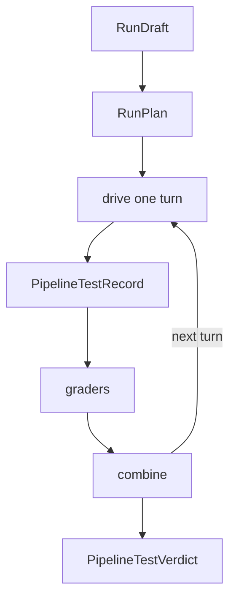

# Pull request description style

How a draft looks. One style for every team: the order of sections, the shape
of each, the rules for tables, diagrams, sizes, and names, the default
template, and a worked example. `SKILL.md` says how the content is gathered
and checked.

## Order

```
## Title
## Description
  ### Commits
  ### Scope change              (when it applies)
  ### Replaced and removed      (when it applies)
  ### Client-facing changes     (when it applies)
## Walkthrough
  spine sentence, overview table, spine diagram
  ### <Stage> ...               (one per stage)
  **Support** line
## Open for review              (when it applies)
<the template's other sections, in its order, or the default template>
```

The title is its own first section, apart from the body, so the user copies
each into its own field on GitHub. When the template has a Description
heading, the Description fills it and the Walkthrough follows it; the
template's other sections come after, in the template's order. A short
description (no spine) has no Walkthrough.

## Title

One line, under about 70 characters, naming what the change adds:
"Pipeline test harness: prep, isolation and the engine". No ticket or PR
number, no emoji, no kind prefix.

## Description

- Open with what the PR adds and what the base lacks, in a short paragraph,
  then the parts as a short list when there are several.
- For a unit of several repositories, a line naming the sibling pull requests
  (number and link, else the branch).
- **Commits**: one bullet per kind present, in the order prep, live, new,
  tests, breaking: `**<kind> (<n> commits):** <one line>`, with sub-bullets
  when the line would run long. The kinds:
  - prep: extractions and renames the rest builds on, behavior unchanged;
  - live: changes code that runs on the base today, behavior unchanged except
    where the commit says;
  - new: code nothing on the base calls yet;
  - tests: tests only;
  - breaking: removes or changes a route, field, table, or check callers rely
    on.
- **Scope change**: only when the PR's scope moved from what reviewers have
  seen: what left, and where it went.
- **Replaced and removed**: with any breaking commit. One bullet per loss, led
  by a bold sentence saying what callers lose, then what replaces it.
- **Client-facing changes**: when routes or fields change. A table (route or
  field, On `<base>`, Here) when every cell is a short phrase, else a list.
- **Open for review** (`##`, after the walkthrough): design points reviewers
  should weigh in on, and known gaps left on purpose, in reviewer language.

## Walkthrough

Ordered by the spine: the flow a reviewer follows to understand the diff.

1. One sentence naming the flow, with the stages in order, and where the paths
   are when they share a root: "A run flows `RunDraft` → `RunPlan` → per turn
   ... Paths are under `libs/modules/src/pipeline/`."
2. With three or more stages, the overview table: columns Stage, Enables, On
   `<base>`, Here; every cell a short phrase (about six words at most). The
   detail stays in the stage outlines.
3. With three or more stages, one mermaid diagram of the spine, one idea only:
   the stages or the flow's main types, with what passes between them on the
   arrows when it helps. Top to bottom (`flowchart TD`); left to right only
   when it is three or four short nodes, since GitHub shrinks a wide diagram
   to the column's width. No diagram per stage.

### Stages

Each stage is one section:

- A `###` heading on one line: `### <Stage> (<path note>; about N non-test
  lines)`, the path note only when the stage's files share a root the spine
  sentence does not give. A heading that would wrap moves its explanation into
  a sentence below it.
- Optionally one sentence under the heading for what a reviewer must know
  first ("Inert unless an execution carries a `testRunId`, which no
  production path sets.").
- The outline, four bold-led bullets:
  - **Enables:** what the stage makes possible, in one line;
  - **On `<base>`:** what the base does today, checked against its code;
  - **Here:** what this PR does instead;
  - **Not yet:** what is left for later, only when something is. Never empty.

  With several points, use sub-bullets, On `<base>` and Here in matching
  order.
- The key files, collapsed:

  ```
  <details>
  <summary>Files</summary>

  - `path/one.ts`, `path/two.ts`: what they define.

  </details>
  ```

  The blank lines inside are needed for GitHub to render the list. One bullet
  per file, or per few files that define one thing, saying what it defines:
  the typed abstraction, or the functions it collects. Small edits and tests
  are left out.

After the last stage, glue no stage covers gets one **Support** line: each
file with what it is in parentheses, as in the example below. It has no size.

## Sizes

Rough, and labeled so: "about" in prose, `~` in tables. Rounded to the nearest
50 below 500, the nearest 100 below 1k, then the nearest 0.5k (1k, 1.5k,
3.5k). Less than 50 is "under 50"; nothing is "none". Sizes count non-test
lines only. No total for the PR and no exact counts.

## Words

- Comparisons name the actual base: **On master:**, **On feat/x:**. Never a
  fixed "On main" when the base is something else.
- Every On `<base>` line has been checked against the base's code.
- No internal ids (records, findings, follow-ups, passes, handoffs), no local
  tooling (`just` recipes, plugin scripts, `.clerk-dev/` paths), and no
  placeholders (`{{...}}`, "TBD", a template's sample text).
- Names are styled as names: "the subject grader", a multi-word name
  hyphenated ("the run-succeeded grader"). Code identifiers and paths in
  backticks.
- Say what a reviewer cannot see from the diff; leave out what is always true
  (that migrations run before the code).
- Plain Markdown with no hard wrapping: one line per paragraph and per bullet.
  GitHub turns every newline in a PR body into a line break.

## Template sections

Keep the template's headings, checkboxes, and order, and fill them with real
content; replace its sample text, keep its links.

- Tick the boxes that apply and put the detail in sub-bullets under them.
- Migrations: one line per migration, per store (Postgres, ClickHouse, ...).
- Dependencies: only real deploy dependencies, with their order. For several
  repositories, the deploy order and what depends on what, in the same words
  in every description.
- Testing: what was actually done: the commands and what they cover, and any
  manual or end-to-end check. No pass counts.

### Default template

For a repository with no template:

```
## Type of change

- [ ] Bug fix
- [ ] New feature
- [ ] Refactor, behavior unchanged
- [ ] Breaking change

## Deployment

- [ ] New environment variables
- [ ] Migrations
- [ ] Other services must deploy first

## Testing
```

Under Deployment: each environment variable with what it sets; one line per
migration per store; the other services and the order between them. Under
Testing: as above.

## Worked example

Cut down from a real PR into `master`, filled into that repository's
template: two of its five stages are left out here, and its sibling PRs are
not named.

````markdown
## Title

Pipeline test harness: prep, isolation and the engine

## Description

Adds a test harness that runs a pipeline through scripted scenarios. The scenario tester on master runs a pipeline once, checks the reply text and the expected tool calls, and keeps nothing. The harness:

- runs the real pipeline runner, apart from production;
- mocks the pipeline's tool calls, per node;
- grades each node and gives a verdict.

### Commits

- **prep (8 commits):** extractions the engine builds on (event source, `toolKeyOf`, mock types, entry injections, failure stages, variable folding, message destinations).
- **live (4 commits):**
  - `test_run` and `pipeline_execution.testRunId`;
  - the test run id and clock carried through child runs;
  - agent memory keyed by test run;
  - strict mocks with real pure tools. The legacy scenario runner and the preview route keep master's behavior.
- **new (4 commits):** types, record, executor and drive; graders and combine; `runPipelineTest` and turn planning; run metrics.
- **tests (1 commit):** integration tests.

## Walkthrough

A run flows `RunDraft` → `RunPlan` → per turn: `drive` → `PipelineTestRecord` → graders → `combine` → `PipelineTestVerdict`. Paths are under `libs/modules/src/pipeline/`.

| Stage | Enables | On `master` | Here |
| --- | --- | --- | --- |
| Script | several turns as one test | one execution per test | a script of turns |
| Execution | telling tests from production | looks like production | tagged with its test run |
| Mocks | mocks aimed at their call | a mock answers any node | mocks per node and turn |
| Expectations | grading each turn | an LLM compares reply text | graders and a subject node |
| Record and verdict | one account of a run | reply text, returned once | a record and a verdict per turn |



### Script (`testing/`; about 1k non-test lines)

- **Enables:** a conversation of several turns as one test.
- **On master:**
  - one execution per test;
  - earlier messages are fixed history, and the pipeline's replies never reach a later turn.
- **Here:**
  - a script of turns, each with its own variables and mocks;
  - history, with delayed replies, carries between turns;
  - clock times and fixture variables are fixed before anything runs, so time-dependent pipelines are reproducible and a broken fixture fails before any execution.
- **Not yet:** saved scenarios, and many scenarios run at once.

<details>
<summary>Files</summary>

- `run-draft.ts`, `conversation-turn.ts`, `test-case-fixture.ts`: the input. A `RunDraft` is a fixture (variables, prior history, contact, entry injections), a script of `ConversationTurn`s, and an optional subject node.
- `run-plan.ts`, `turn-planning.ts`: `planRun` turns a draft into a `RunPlan`: every turn gets a trigger and a clock time, and fixture variables are resolved up front.
- `runner.ts`: `runPipelineTest`, the entry point. Opens a test run, then plays the turns in order and halts on a hard failure (later turns are `skipped`).
- `drive.ts`, `pipeline-test-executor.ts`: `drive` executes one turn through the real `PipelineRunner`; an engine exception becomes `EngineRunError`.

</details>

### Execution (outside `testing/`; about 100 non-test lines)

Inert unless an execution carries a `testRunId`, which no production path sets.

- **Enables:** telling a test's executions apart from production.
- **On master:**
  - a test's executions look like production runs;
  - agent memory is keyed by the contact's phone when there is no conversation, so a test read and wrote a real contact's memory.
- **Here:**
  - every execution a test run starts, sub flows and child agents included, carries its `testRunId`;
  - agent memory is keyed by the test run.

<details>
<summary>Files</summary>

- `entities/test-run.entity.ts`, `pipeline-execution.entity.ts`: a `TestRun` row per run; every execution it starts carries its id.
- `tools/child-agent-provider.ts`, `node-runners/node-runner-api.ts`: a child run inherits the parent's test run id and scripted clock.
- `node-runners/messaging-agent-memory-key.ts`: the memory key rules in one function; a test run gets its own key.

</details>

### Mocks (about 250 non-test lines)

- **Enables:** mocks aimed at the call they answer.
- **On master:**
  - a mock answers any node;
  - only a mock's first pinned param is checked;
  - every tool call needs a mock, pure tools included.
- **Here:**
  - a mock names the calling node (inside sub flows by resource path);
  - each turn brings its own mocks;
  - every pinned param must match;
  - pure tools (code sandbox, set variables, duration, execution status) run for real.
- **Not yet:** chosen sending tools run for real.

<details>
<summary>Files</summary>

- `tools/mock-tool-provider.ts`, `tools/tool-call-mock.ts`: `MockToolFactory` serves `ToolCallMock`s. A call no mock answers fails with `UnmockedToolCallError`, which lists the near misses (wrong params, used up, or pinned to another node).

</details>

**Support**: `testing/harness-failure-messages.ts` (user-facing failure text), `testing/run-telemetry.ts` (metrics and a log line per finished run).

## Type of change

- [ ] Bug fix (fixes an issue)
- [x] New feature (adds functionality)

## Checklists

### Deployment

- [ ] New environment variables are required for the code to run? (message Will)
- [x] PR contains database migrations. Migrations should be [run before the PR is merged](https://www.notion.so/clerk-chat/Running-migrations-in-staging-prod-4bd3068bdf654622bcc69fce55cb1782)
  - Postgres: `test_run`, `pipeline_execution.testRunId`, and two indexes built concurrently (non-transactional).
  - ClickHouse: `testRunId` on `pipeline_execution_changelog` and `_latest`.
- [ ] Any other FE or infrastructure dependencies?

# Testing

Smoke-tested end to end with the clerkai and agent-swarm branches of the same feature.
````
