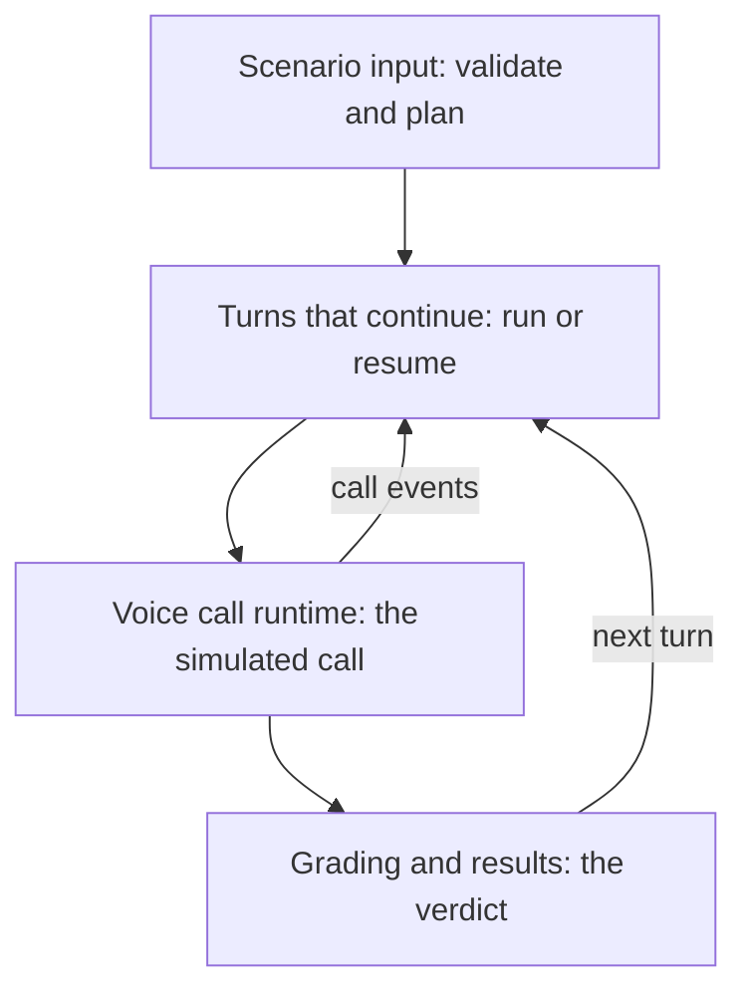

# Pull request description style

How a draft looks. One style for every team: the order of sections, the shape
of each, the rules for tables, diagrams, sizes, and words, the default
template, and a worked example. `SKILL.md` says how the content is gathered
and checked.

## Order

```
## Title
## Description
  base line                     (when the base is not the default branch)
  core terms                    (a short paragraph)
  what the base does, what this PR adds (a paragraph, then bold-led bullets)
  sibling pull requests         (a bullet list, for several repositories)
  ### Overview of commits
    #### Conventions             (when the commits carry subject markers)
    #### Groups
  ### Scope change              (when it applies)
  ### Client-facing changes     (when it applies)
## Walkthrough
  intro sentences, spine diagram, contents table
  ### <Stage> ...               (one per stage)
  ### Changes to <existing code> (code the base already runs, when any)
  Other files, outside any stage (collapsed)
## Left out on purpose          (when it applies)
  ### Known bugs / follow-ups
  ### Design questions
<the template's other sections, in its order, or the default template>
```

The title is its own first section, apart from the body, so the user copies
each into its own field on GitHub. When the template has a Description
heading, the Description fills it and the Walkthrough follows it; the
template's other sections come after, in the template's order. A short
description (no spine, or a small repository in a larger unit) has no
Walkthrough: Description, Overview of commits, Left out on purpose, and the
template.

## Title

One line, under about 70 characters, naming what the change adds: "CRM contact
sync: retries and conflict resolution". No ticket or PR number, no emoji, no kind
prefix.

## Description

The Description is a newcomer's first contact with the change. Reviewers range
from the code's owners to people new to it; err toward explaining.

- **The base, once.** When the base is not the repository's default branch,
  open with one line saying so: "This PR targets `feat/x`, the branch that
  holds ..., not `master`." Elsewhere compare as Before and After.
- **Core terms.** Before the change list, define only the nouns the whole PR
  rests on (a sync, a conflict), one sentence each, and say whether each is
  local to the feature or a general term ("'Sync' here means one import from
  the CRM. It is not database replication."). Two or three at most, and only
  nouns a reviewer meets in the product or the API; code names (types,
  interfaces, internal roles such as `SyncCursor` or a "resolver") stay in
  the walkthrough. Every other term waits for the bullet that introduces it.
- **Coined terms.** A term the branch coins (one with no hits on the base,
  such as "hold") is defined in the bullet where it first appears, in its own
  sentence: what it is, where it is set, and what existing thing it relates to.
  Naming it in passing ("unless a hold applies") is not a definition.
- **Before and after.** A short paragraph on what the base does, introducing
  the base by role ("On the base branch, `feat/x`, ..."), then "This PR ..."
  and the parts as bullets. Each bullet leads with a bold short name, then says
  in plain words what the thing is and why, then its mechanics. Four or five
  bullets at most, grouped by what a reviewer or user gets, not one per
  stage.
- **Sibling pull requests**, for several repositories: a bullet list, one per
  repository, each with its number and link (else the branch) and what it
  holds.

### Overview of commits

The group's purpose and a few examples; the full list is in the commits. No
commit counts.

- **Conventions** (`####`), only when the branch's commit subjects carry
  types (`refactor(<area>):`, `change`, `!`, as `skills/review/commits.md`
  lists them): what each type present means in reviewer terms, as bullets. Say why a refactor can be trusted (it
  changes no behavior and existing tests guard it) and what it allows
  (cherry-picking it on its own), not only what it does not touch.
- **Groups** (`####`, or no heading when there are no Conventions): one
  bold-led bullet per group present, in this order, each opened by a sentence
  saying what the group is for:
  - **Refactors.** Extractions and renames the rest builds on, behavior
    unchanged.
  - **Changes to deployed code.** Code that runs in production today and now
    behaves differently. On a stacked base (a feature branch), code that exists
    only on the base is not deployed: name the group "Changes to code on the
    base" for it, and keep "deployed" for code the default branch has.
  - **New code**, named for what it is ("New sync code"). Code nothing on
    the base calls yet.
  - **Tooling.** CI, checks, and housekeeping; nothing deployed
    changes.
  - **Tests.** Tests only.
  - **Docs.** Docs only.
  - **API break**, or the kind of break ("Schema break with backfill",
    "Behavior break"). What breaks, whether it is public or customer-facing,
    and who calls it. Only the repository that changes the contract has this
    group; a client that follows the change says so in its other groups and
    in its deployment section.
- Detail goes where the review is: the new code and the changes to deployed
  code get bullets; refactors, tooling, tests, and docs a line or a few
  examples each.
- Any list of two or more items is a bullet list.
- Cut qualifiers the group heading already implies, especially one a sibling
  repository's PR makes false ("nothing calls it", when the sibling does).

### Scope change

Only when the PR's scope moved from what reviewers have seen: what left, and
where it went.

### Client-facing changes

When routes or fields change. Input (what callers send) and output (what they
get back) get separate tables, input first, and a field goes in the table of
the direction it travels; a field in both appears in both. Each table is
introduced with every route it applies to, as bullets, saying when the fields
are common to all of them. Columns: Field, Before, After. Every cell is a
short phrase, about six words; detail goes in the stage that explains the
field. Every field the change adds, removes, or renames in a request or
response gets a row, the main break above all. An empty side says "absent" (a
field) or "none". A removed field's
After cell says "removed" and names what replaces it. A break the tables
cannot show (a name checks can no longer read, a behavior callers relied on)
gets one bullet under the table, led by what callers lose. There is no
separate section for what was replaced or removed.

In a client repository, the section is the API it consumes, named "API fields
the UI reads and writes" (or the client's equivalent), with the server's
routes named.

## Walkthrough

Ordered by the spine: the flow a reviewer follows to understand the diff.

1. A few sentences tying the parts together: the stages are what every unit
   of the flow passes through, the diagram shows how it moves between them,
   the table lists them linked to their sections. Say which section is not a
   stage of the flow when one is not (deployed code underneath it). Give the
   paths' shared root.
2. With three or more stages, one mermaid diagram of the spine, one idea only,
   its nodes carrying the section names. Top to bottom (`flowchart TD`); left
   to right only when it is three or four short nodes, since GitHub shrinks a
   wide diagram to the column's width. No diagram per stage.
3. The contents table: columns Section (an anchor link to the stage's
   heading), What changes (a short phrase), Non-test lines (`~550`).

### Stages

Each stage is one section, in this shape:

- A bare `###` heading, the stage's name only, so its GitHub anchor stays short
  and stable (`#conflict-resolution`). Sizes live in the contents table.
- **Key idea:** one or two sentences, the concept a reviewer needs before the
  rest.
- A Before/After table, one row per aspect (blank first header, then Before,
  After); a side with nothing says "none". Every cell is a short phrase,
  about six words; detail goes in the groups below. The cells say what the
  change enables; there is no separate Enables line.
- At most three groups of bullets, each under a short line naming what it
  holds ("What validation checks:", "Retrying a failed sync:"), chosen for the
  stage, about six bullets each. Each bullet says what a reviewer must know to
  judge the change, not how the code does it: implementation detail goes in
  Files, and mechanics a reviewer may want go in a collapsed
  `<summary>How it works</summary>` block after the groups. No catch-all group
  ("Smaller changes"); a change too small for a group is left to the diff.
  Keep enablers apart from what they enable. A group whose items pair up as
  before and after becomes a table.
- When the diff adds modes or options a user picks between, a `####`
  subsection with a comparison table, in the stage that implements them, so the
  capability has one home.
- The key files, as a table in a collapsed block:

  ```
  <details>
  <summary>Files</summary>

  | File | Defines |
  | --- | --- |
  | `src/sync/retry.ts` | `RetryPolicy`, the backoff loop |

  </details>
  ```

  The blank lines inside are needed for GitHub to render the table. One row
  per file, or per few files that define one thing, naming the types and
  functions it defines. Small edits and tests are left out.

A stage has no open items of its own; they go under Left out on purpose.

About six stages at most. A stage under about 300 non-test lines folds into
the neighbor it serves (the stage for changes to existing code never folds); when it is something a user picks between (modes,
options), it becomes a `####` subsection there.

Changes to code the base already runs (a framework layer the feature runs on,
a shared service) form one stage of their own, after the flow's stages, named
for that code ("Changes to the job runner"); the intro says it is not a stage of the flow. Its
Before/After table holds the behavior changes, and its one group the
refactors. The flow's stages never carry such changes, not even as a
subsection, and may link to this stage. When there are none, there is no such
stage.

After the last stage, the files no stage covers get the same collapsed table
under `<summary>Other files, outside any stage</summary>`, never a bare line
that reads as part of the last stage.

## Left out on purpose

What is open, gathered from every stage, opened by one line: each item can be
fixed on this branch or in a follow-up, and reviewers may weigh in on which.
Subsections, each only when it has items. Gaps (what the change does not
cover yet) are not listed in a first draft: the skill reports them, and the
user adds the ones worth a reviewer's time while refining, as a **Gaps**
subsection between the two below.

- **Known bugs / follow-ups**: behavior that is wrong today, kept only when a
  reviewer could hit it by using the feature. Bugs in internals no use of the
  feature reaches are left out.
- **Design questions**: only what is undecided. A built feature is never
  phrased as a choice; ask about the part that is actually open, and link to
  where the feature is described.

Each item leads with a bold sentence, is phrased neutrally (not as already
decided), and links back to its stage: `([Conflict resolution](#conflict-resolution))`.
A bug lives in the draft of the repository whose code has it; a sibling's
draft does not repeat it.

## Sizes

Rough, and labeled so: "about" in prose, `~` in tables. Rounded to the nearest
50 below 500, the nearest 100 below 1k, then the nearest 0.5k (1k, 1.5k,
3.5k). Less than 50 is "under 50"; nothing is "none". Sizes count non-test
lines only. No total for the PR and no exact counts.

## Words

- **Code-style names.** Branch names, routes, fields, identifiers, and paths
  are in backticks, prose included.
- **Precise nouns.** Qualify a generic noun on first use (a *background*
  job, an *HTTP* request, a *database* transaction); a reviewer outside the work
  cannot tell which one is meant.
- **Name the path, not "production".** "for live traffic", "in the test runner";
  avoid "in production" when the PR is about test tooling.
- **No bare "Here".** In prose say "This PR" or "This change".
- **The codebase's verbs.** Use the verb the code uses for the action ("dispatch"
  a job, when the code says dispatch), not an invented one.
- **Statements stand alone.** Reread each bullet as someone who does not know
  the term, and name the thing: which listing, which route.
- **Unambiguous definitions.** Define a new field in its own sentence; no
  appositives or bare pronouns ("its") in a definition.
- **Named AI agents** (an assistant with a name) are referred to by name or "it", never a pronoun
  inferred from the name.
- **One name per thing**, the same in every draft of a unit, and each draft
  defines the shared core terms in the same words, so each PR stands alone.
- No internal ids (records, findings, follow-ups, passes, handoffs), no local
  tooling (`just` recipes, plugin scripts, `.clerk-dev/` paths), and no
  placeholders (`{{...}}`, "TBD", a template's sample text).
- Say what a reviewer cannot see from the diff; leave out what is always true
  (that migrations run before the code).
- List items end with no punctuation, or a period when they hold full
  sentences; never a trailing semicolon. A bullet with more than one fact gets
  sub-bullets.
- Plain Markdown with no hard wrapping: one line per paragraph and per bullet.
  GitHub turns every newline in a PR body into a line break.

## Template sections

Keep the template's headings, checkboxes, and order, and fill them with real
content; replace its sample text, keep its links.

- Tick the boxes that apply and put the detail in sub-bullets under them.
- Migrations: one line per migration, per store (Postgres, ClickHouse, ...).
- Dependencies: only real deploy dependencies, with their order. For several
  repositories, the deploy order and what depends on what, in the same words
  in every description.
- Testing: what the user says was run (commands, manual or end-to-end
  checks). Without an answer, the test files and what they cover, as bullets.
  No pass counts.

### Default template

For a repository with no template:

```
## Type of change

- [ ] Bug fix
- [ ] New feature
- [ ] Refactor, behavior unchanged
- [ ] Breaking change

## Deployment

- [ ] New environment variables
- [ ] Migrations
- [ ] Other services must deploy first

## Testing
```

Under Deployment: each environment variable with what it sets; one line per
migration per store; the other services and the order between them. Under
Testing: as above.

## Worked example

Cut down from a real PR into a feature branch, filled into that repository's
template: four of its six stages and most bullets are left out here.

````markdown
## Title

Pipeline test harness: voice call scenarios

## Description

This PR targets `feat/pipeline-test-merge`, the branch that holds the text-only pipeline test harness, not `master`.

The harness tests a pipeline with scenarios. A scenario is a script of turns. A turn is one input to the pipeline (a customer message, or an event such as a call starting), followed by everything the pipeline does in response until it waits for the next input. "Turn" is a harness term here. It is not the same as an agent's LLM turn in the engine.

On the base branch, `feat/pipeline-test-merge`, the harness drives text conversations only: voice triggers are rejected, every conversational turn starts a new pipeline run, and a turn reports the messages the contact received.

This PR lets a scenario drive a voice pipeline as one call, turn by turn:

- **Caller turns and call events.** A turn can be a line the caller says, or an event the call raises (call ended, voicemail). On a live call, the voice service runs an agent that answers the caller for the pipeline. In a test there is no voice service, so the scenario either scripts the agent's replies per turn (fixed replies, like a mock), or pins the agent to an LLM. A pin is a new fixture setting, `fixture.voiceAgent`, that puts the whole scenario in LLM mode and can name a model.
- **One execution across turns.** On a live call, the whole call is one pipeline execution: it pauses while it waits for the caller and resumes on the voice service's next event. The harness now does the same.

Sibling pull requests:

- clerkai `feat/pipeline-test-voice`: the scenario editor and results for calls
- agent-swarm `feat/pipeline-test-voice`: Belle authoring and running voice cases

### Overview of commits

#### Conventions

Commits are small and each has one kind of change, marked by its type:

- `refactor(pipeline):` changes deployed pipeline code without changing behavior, relying on the existing pipeline tests to catch a regression. These commits touch no harness code, so they can be cherry-picked onto `master` on their own.
- `fix` and `change` alter behavior production has today; `feat` adds code nothing deployed runs yet.
- `test` adds or changes tests only, and a `!` marks a change to a contract callers rely on.

#### Groups

- **Refactors.** Behavior-preserving extractions the voice work builds on, such as:
  - shared node path helpers
  - a shared voice model resolver
- **Changes to deployed code.** A few commits change how production code behaves, mostly to keep test runs isolated from live traffic. For example:
  - the voice service's callback routes answer 404 for executions that belong to a test run, so a harness execution cannot be driven from outside
  - the pipeline execution listing no longer shows executions created by test runs
- **New harness code.** The walkthrough below covers it in detail.
- **Tests.** Tests only.
- **API break.** Turn results carry `interactions` instead of `responses` (see below). The scenario API is internal: only clerkai and agent-swarm call it, and both have sibling PRs that read the new shape.

### Client-facing changes

Turn results, on these routes:

- `POST /pipeline-scenarios/:scenarioId/run`
- `GET /pipeline-scenarios/results/:testRunId`

| Field | Before | After |
| --- | --- | --- |
| `responses` | the contact's messages | removed, see `interactions` |
| `interactions` | absent | ordered list, seven kinds |
| `firstNodeExecutionId` | absent | where the turn's part begins |

- **Checks can no longer read `responses`.** They read `interactions`, and `call` for a summary of the call.

## Walkthrough

Every turn of a scenario passes through the stages below. The diagram shows how a turn moves between them. The table lists them again, linked to their sections, with what each changes. Paths are under `libs/modules/src/pipeline/`.



| Section | What changes | Non-test lines |
| --- | --- | --- |
| [Scenario input](#scenario-input) | scenarios can script a call | ~550 |
| [Turns that continue](#turns-that-continue) | later turns resume the paused execution | ~800 |
| [Voice call runtime](#voice-call-runtime) | a simulated call plays the voice service | ~1.5k |
| [Grading and results](#grading-and-results) | failed steps graded per turn | ~750 |

### Scenario input

**Key idea:** a scenario's turns now decide its channel. A script with a caller turn or a call event is a voice script, and anything else is text, as before. The run plan carries that channel, and the rest of the harness branches on it.

What a scenario can say:

| | Before | After |
| --- | --- | --- |
| Turn kinds | `message`, `event` | adds `caller`, a line the caller says |
| Voice triggers | rejected | call events are turns, and a call starts with a caller turn |
| Voice agent | none | scripted replies on each caller turn (`agent`), or a pin to an LLM (`fixture.voiceAgent`) |

What validation checks, before anything runs:

- A call script starts with a caller turn, and the pipeline needs a node listening for `callStarted`
- `fixture.voiceAgent` is allowed only on a voice script, never alongside scripted replies
- Tool-call arguments and pause events are capped at 16 KB of JSON

<details>
<summary>Files</summary>

| File | Defines |
| --- | --- |
| `testing/script-channel.ts` | `ScriptChannel`, `scriptChannelOf` |
| `testing/scenario-validation.ts`, `validation-issues.ts` | the call and voice agent checks, and their issue codes |

</details>

### Turns that continue

**Key idea:** a turn now starts in one of two ways. It either runs (a new execution from a trigger, as before) or continues (it resumes the execution an earlier turn of the same test run paused). On a call, every turn after the first continues.

| | Before | After |
| --- | --- | --- |
| Starting a turn | always a new run | a new run, or continue the paused execution |
| Where a turn's part begins | not tracked | each turn marks its first node execution |

Resuming within a turn:

- While the execution is paused, `drive` asks the event sources for an event and continues the execution
- It is capped at 50 resumes per turn and by the run deadline
- On any give-up, every execution in the paused chain is marked failed, so nothing is left paused

<details>
<summary>Files</summary>

| File | Defines |
| --- | --- |
| `testing/drive.ts` | `DriveStart` (run or continue), the resume loop, the give-up paths |
| `testing/resume-event-source.ts` | `ResumeEventSource`, `failPausedChain` |

</details>

<details>
<summary>Other files, outside any stage</summary>

| File | Defines |
| --- | --- |
| `testing/run-telemetry.ts` | metrics per finished run |

</details>

## Left out on purpose

Each item below is open: it can be fixed on this branch or in a follow-up, and reviewers may weigh in on which.

### Known bugs / follow-ups

- **Parallel branches that both pause keep only the last pause.** The earlier branch never resumes. ([Turns that continue](#turns-that-continue))

### Design questions

- **How far to trust a passing LLM-mode scenario.** Given how the LLM mode differs from a live call, should it be read as "the prompt behaves sensibly" rather than "the call works"?

## Type of change

- [ ] Bug fix (fixes an issue)
- [x] New feature (adds functionality)

## Checklists

### Deployment

- [ ] New environment variables are required for the code to run? (message Will)
- [ ] PR contains database migrations. Migrations should be [run before the PR is merged](https://www.notion.so/clerk-chat/Running-migrations-in-staging-prod-4bd3068bdf654622bcc69fce55cb1782)
- [x] Any other FE or infrastructure dependencies?
  - Deploy this first, then clerkai `feat/pipeline-test-voice` and agent-swarm `feat/pipeline-test-voice`: turn results change from `responses` to `interactions`, and both read the new shape.

# Testing

- `testing/__tests__/voice-call.spec.ts`: voice calls end to end through VoiceBot subjects and voice events
- `controllers/__tests__/voice-pipeline.controller.spec.ts`: the refusal of test-run executions
````
